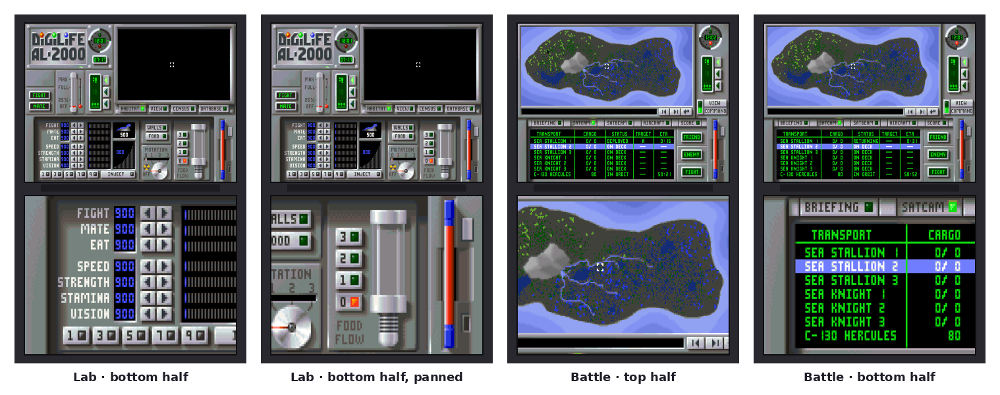
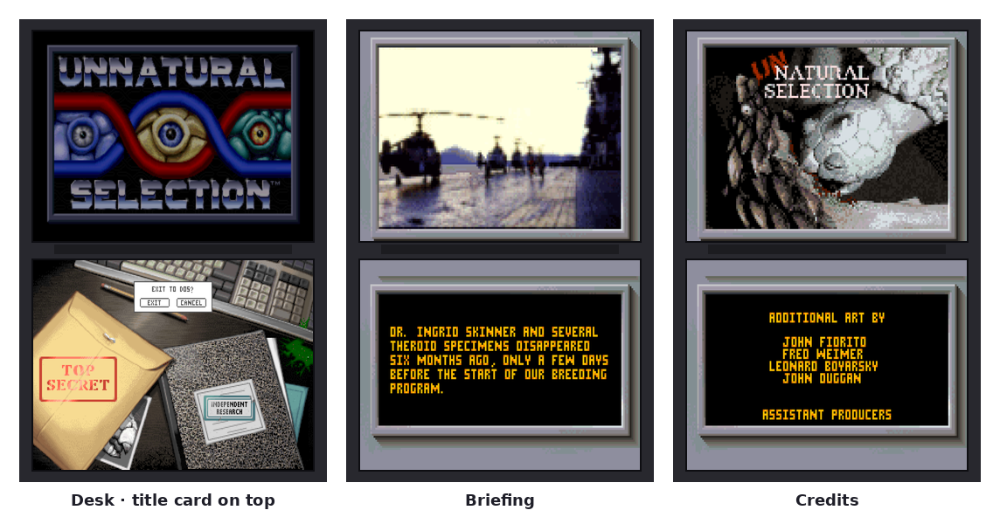

# Unnatural Selection DS

A dual-screen port of *Unnatural Selection* (Maxis, 1993) for the Anbernic RG DS Plus running ROCKNIX.

The original DOS game runs in DOSBox Pure. `usds` is a small libretro frontend, written for this port, that:

- shows the whole game on the top screen;
- shows the whole game, its top half or its bottom half on the bottom touch screen, split at the top edge of the DigiLife floppy drive (row 120 of 200), with L/R panning;
- turns taps into mouse clicks and hands the game's own controls (zoom buttons, the floppy-drive menu) to the face buttons.

See [`port/unnaturalselection/README.md`](port/unnaturalselection/README.md) for installing and the control layout.



Outside the lab and battle the layout follows the game: the title card stays on the top screen over the desk, and briefings and credits put the picture monitor on top and the text monitor below.



## Layout

| Path | What |
|---|---|
| `src/usds.c` | The frontend: views, touch (raw evdev or SDL), buttons, on-screen keyboard |
| `port/` | What goes on the SD card: launcher script, config, README |
| `cross/build_aarch64.sh` | Cross-build for ARM64 with clang + lld, no sysroot needed (SDL2 headers only) |
| `build_x86.sh` | Desktop build for testing: both screens stacked in one window, mouse acts as the stylus |
| `tools/` | Headless test runner and a synthetic touch-panel feeder |
| `docs/` | Mockups and captures |

Game files are not included. Copy your own copy of the DOS game into `port/unnaturalselection/gamedata/`.

## Building

```sh
SDL_INC=/path/to/SDL2/include cross/build_aarch64.sh   # -> build/aarch64/usds
SDL_INC=/path/to/SDL2/include ./build_x86.sh           # -> build/usds-x86_64
```

Copy `build/aarch64/usds` into `port/unnaturalselection/`, then copy `port/*` to `/storage/roms/ports/` on the device.
